<div align="center">

# Animal Rescue Site Kit

**A free, white-label WordPress kit that gives small animal rescues a website they can run themselves.**

[](LICENSE)
[](https://wordpress.org/download/)
[](https://www.php.net/)
[](https://github.com/michaelbystryk/animal-rescue-site-kit/actions/workflows/test.yml)

[Install](#install-no-coding-needed) · [How it works](#how-it-works) · [Screenshots](#screenshots) · [Live reference](#live-reference)

<br>

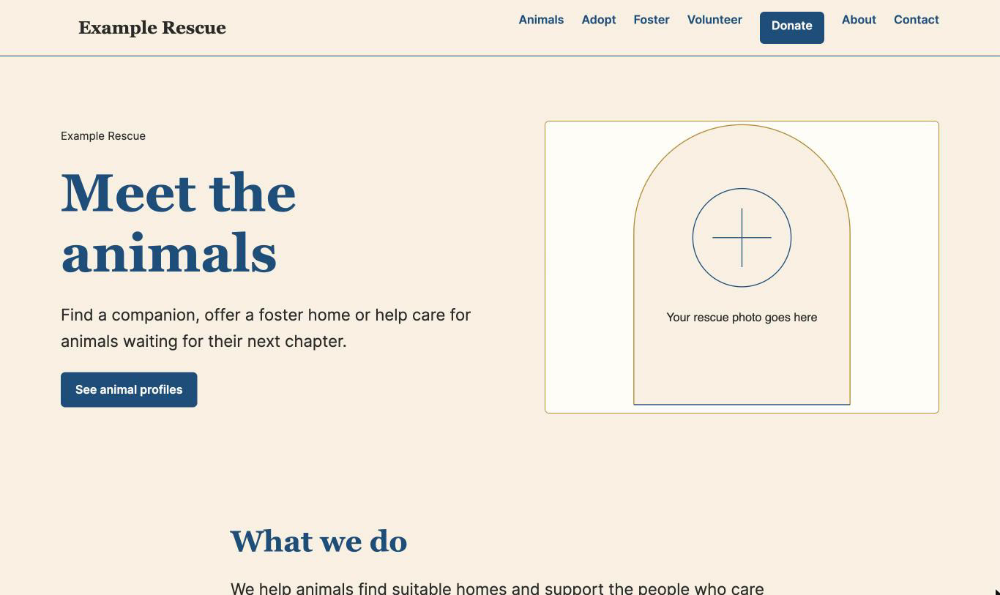

</div>

## Why I built this

I volunteer with a dog rescue whose animals are listed on Petstablished. Their old website couldn't show those listings well, so someone had to copy every update by hand. I built them a site that stays in sync on its own, and since plenty of small rescues have the same problem, I turned it into a free kit.

I'm a product manager, not an engineer. The code was written by AI coding agents (Claude, Codex and Gemini). I decided what to build, reviewed the work and tested it.

## What you get

The kit has two parts: **Homeward Rescue** (`plugin/homeward-rescue/`), the plugin that does the work, and **Homeward** (`theme/homeward/`), an optional block theme made for it. Any block theme works, but this one is ready to go. "Homeward" is a placeholder name. Your rescue's name, logo, colours and fonts replace it everywhere visitors can see.

| | |
| --- | --- |
| **Animal sync** | Adoptable animals come from Petstablished and refresh on a schedule. |
| **Filters** | Visitors filter by species, age, size and breed family. |
| **Animal profiles** | Photos, compatibility and health icons, share buttons and a local QR code. |
| **Kennel cards and posters** | Staff print half page cards or full page posters on Letter or A4, each with a QR code to the animal's page, one at a time or in bulk. |
| **Stories and testimonials** | Adoption stories and adopter quotes, each linked to the animal. |
| **Events** | Post adoption days and fundraisers in the normal editor. |
| **Donate panel** | PayPal, a card link, and e-Transfer details with a copy button. |
| **Contact form** | Topics such as adopt, foster and volunteer, with spam protection. |
| **Setup wizard** | Six short steps, saved as you go. No code. |
| **Practice content** | Fictional pages and animals so you can see the finished site first. |
| **Volunteer guide** | A plain-language guide to every page and block. |
| **Statistics (optional)** | Optional PostHog visitor statistics, off until you add a key. |
| **Fonts and access** | Twelve self-hosted fonts, readable colours, accessible and mobile friendly. |

## How it works

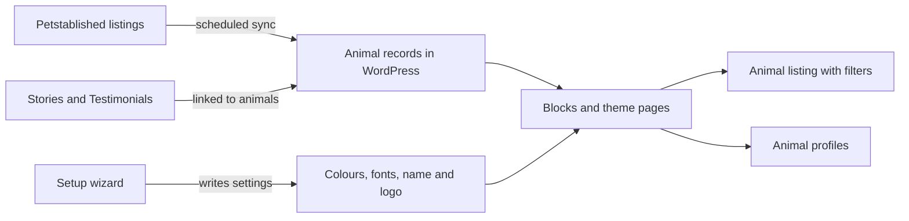

The plugin fetches your public listings on a schedule and saves each animal as a normal WordPress record. The listing, filters and profiles are built from those records, so the site stays fast and keeps working if Petstablished is slow. Stories and testimonials are written in the usual editor and linked to the animal they are about. The wizard stores your name, logo, colours and fonts as settings, and the theme reads them.

## Screenshots

<table>
  <tr>
    <td width="50%">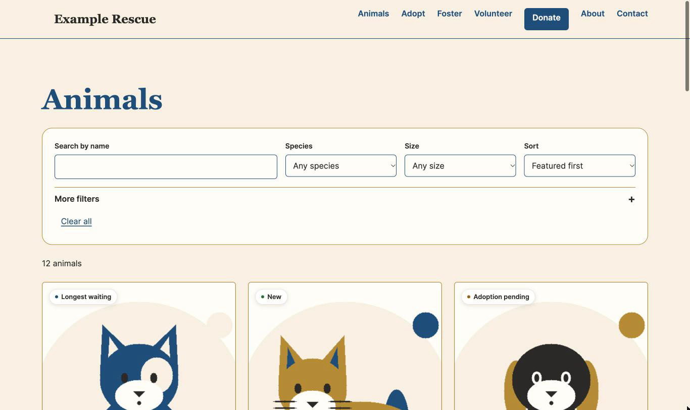<br><sub><b>Animals.</b> Filter by species, age, size and breed family.</sub></td>
    <td width="50%">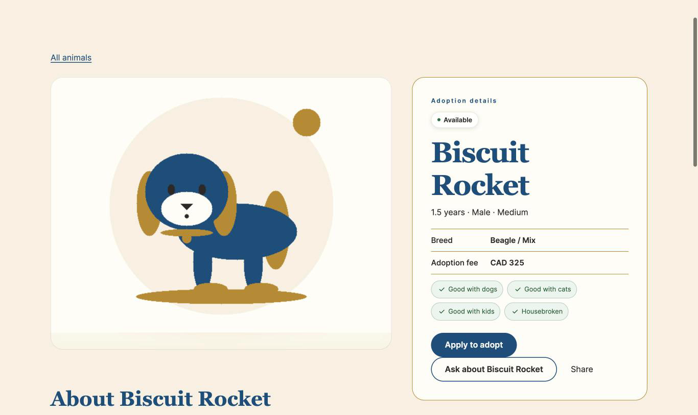<br><sub><b>Profiles.</b> Photos, details, share buttons and a QR code.</sub></td>
  </tr>
  <tr>
    <td width="50%">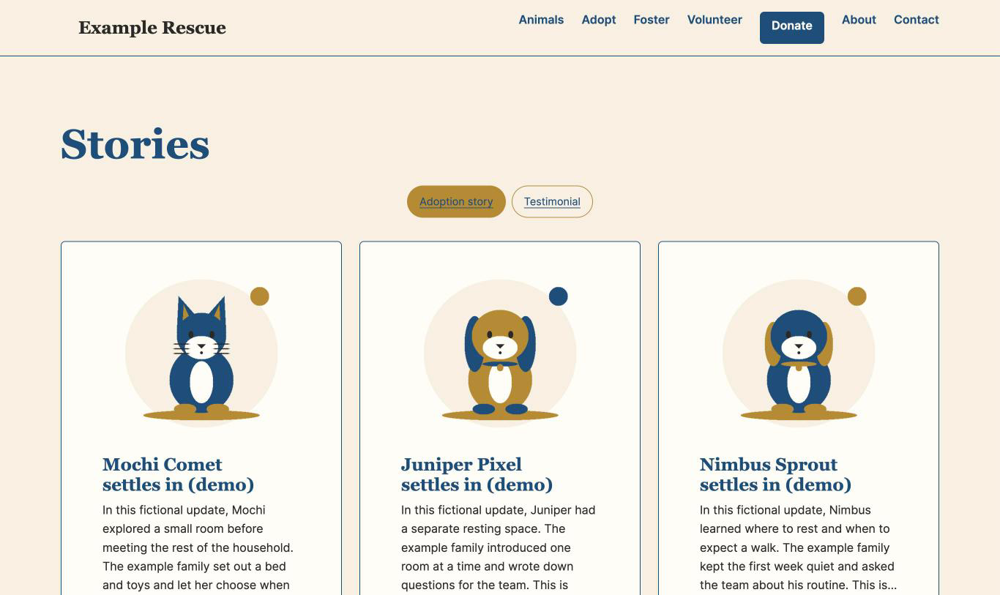<br><sub><b>Stories.</b> Adoption stories and quotes linked to animals.</sub></td>
    <td width="50%">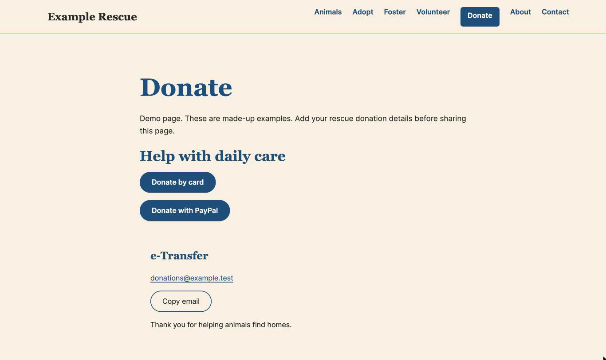<br><sub><b>Donate.</b> PayPal, card, and e-Transfer with a copy button.</sub></td>
  </tr>
</table>

### Kennel cards and posters

Print a card or a full page poster for any animal, for kennels, adoption events and noticeboards. The QR code opens the animal's page, so people can apply from their phone.

<p align="center">
  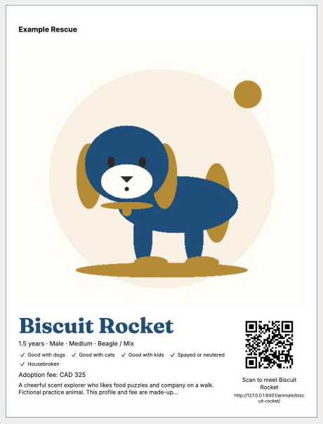
</p>

### Setup in six steps

<p align="center">
  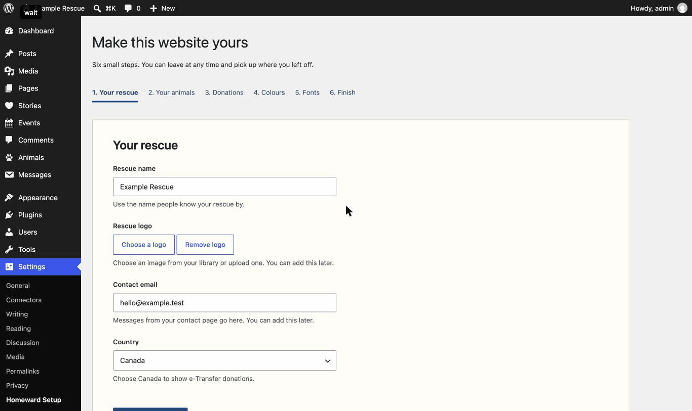
</p>

Pick a font pairing by seeing it, not by reading names. Each card is drawn in its own fonts, and the preview updates as you choose.

<p align="center">
  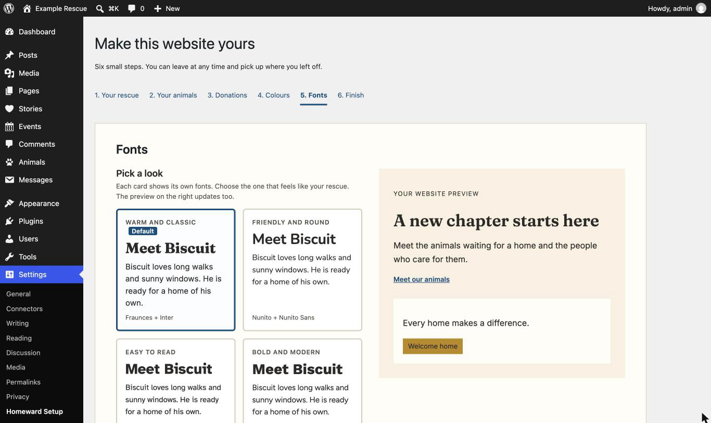
</p>

## Install (no coding needed)

You need a WordPress site (version 6.7 or newer) where you can install plugins and themes. Most hosts offer this.

1. Download `homeward-rescue.zip` and `homeward.zip` from the [latest release](https://github.com/michaelbystryk/animal-rescue-site-kit/releases).
   Or build them yourself with `bin/build-zips.sh`.
2. In WordPress, go to **Plugins > Add New > Upload Plugin**, choose `homeward-rescue.zip`, then **Install** and **Activate**.
3. Go to **Appearance > Themes > Add New > Upload Theme**, choose `homeward.zip`, then **Install**. You do not need to activate it, because the wizard can do that.
4. The setup wizard opens. Work through the six steps:
   1. **Your rescue:** name, logo, contact email and country.
   2. **Your animals:** your Petstablished shelter number, with a live check that finds your animals.
   3. **Donations:** your PayPal link, plus an optional card link or e-Transfer email.
   4. **Colours:** pick your palette. The wizard warns you if text would be hard to read.
   5. **Fonts:** pick a ready-made look from cards that show real fonts, or mix your own from the twelve that come with the kit.
   6. **Finish:** turn on the theme, create your pages and menu, and optionally load practice content. Optional visitor statistics are also set here.

You can leave the wizard and come back later. It remembers where you were.

**Practice content.** On the Finish step you can load fictional animals, stories and pages so the site looks complete straight away. Everything is labelled as practice. When you are ready, go to **Settings > Homeward Rescue** and click **Remove practice content**. The sample animals, stories and pictures go, and the pages you created stay. [docs/page-guide.md](docs/page-guide.md) explains each page and how to swap in your own words.

<details>
<summary><b>Try it without a Petstablished account</b></summary>

<br>

Enter `0` as the shelter number in step 2. The wizard switches to sample animals automatically, so you can explore the listing, filters and profiles before connecting anything.

</details>

## Petstablished setup

The kit reads your public adoptable-animal listings from Petstablished and refreshes them on a schedule. Each rescue enters its own shelter number in the wizard. Nothing is shared between sites.

> **Please note:** this kit is not made by, affiliated with or endorsed by Petstablished or Wagtopia. It uses Petstablished's public listing data, which is not an official, documented API and can change without notice. If it changes, animal sync may stop until the kit is updated. Your existing animals stay on your site in the meantime.

Petstablished is optional. Animal profiles, stories, testimonials, events and donation pages all work with animals you add by hand. In Animals, choose Add New and fill in the manual profile: availability, species, sex, age group, size, breed, adoption fee, compatibility, description and featured photo. Synced animals retain their source-owned fields; sync and retention never change manual animals.

Empty feeds and large availability drops are held for review. The admin notice and Site Health show the counts and a **Confirm and apply** button. Three consecutive matching listing runs apply the drop automatically. The `homeward_sync_drop_confirm_runs` filter changes that threshold. An animal missing across that many valid listing runs is marked gone even if the partial feeds differ. Failed requests and malformed responses do not count as valid listing runs.

Demo import skips existing rescue pages. It only fills an unchanged page created by the setup wizard. Removal trashes unchanged demo posts, restores unchanged filled wizard pages and lists modified records that were kept. Pictures referenced by other records, including posts in Trash, are retained. Legacy demo records without a saved fingerprint are kept for manual review.

## Visitor statistics (optional)

The kit can send simple visitor statistics to [PostHog](https://posthog.com). It is off until you enter a key.

1. Create a free PostHog project.
2. Copy the project API key. It starts with `phc_`.
3. Paste it on the wizard's Finish step, or later in **Settings > Homeward Rescue**.
4. Pick **United States** or **European Union** to match your PostHog project.

For self-hosted PostHog, use **Advanced: custom host** in settings. Enter your secure `https://` host, or leave it blank to use the selected region.

**What is collected:** page views, clicks, page speed and error reports from visitors. Text on the page is masked.
**What is not:** logged-in users and visitors who send Do Not Track are excluded, and session recording, heatmaps and surveys are always off.

**Cookies:** by default PostHog keeps visitor identifiers in memory only. If you tick **Recognize returning visitors** in settings, it stores cookies and local storage on visitors' devices to recognise return visits. Either way, mention PostHog in your privacy policy and cookie notice where your local rules require it, and collect any consent they ask for.

For config files, the keys are `posthog_key` and `posthog_region` (`us` or `eu`). Leave the key blank to keep statistics off:

```json
{
  "settings": {
    "posthog_key": "",
    "posthog_region": "us"
  }
}
```

**Profile features and A/B tests:** the donate card, fee explainer, adoption steps, waiting counter and household share card each have an on/off switch in settings, and PostHog can optionally split visitors to test them. See the [A/B test guide](docs/posthog-experiments.md).

## Customising

Everything lives in **Settings > Homeward Setup** (the wizard) and **Settings > Homeward Rescue**.

- **Name and logo:** wizard step 1.
- **Colours:** wizard step 4. The default is deep blue and cream, and the wizard checks that text stays readable.
- **Fonts:** wizard step 5. Pick a pairing card (the default is Fraunces for headings with Inter for reading) or use Mix your own. Twelve bundled families: Fraunces, Lora, Source Serif 4, Playfair Display, DM Serif Display and Merriweather (serif), then Inter, Atkinson Hyperlegible, Nunito Sans, Figtree, Work Sans and Nunito (sans serif). They are stored on your own site, so visitors' browsers never contact Google.
- **Words:** if you rescue cats or other animals, set the animal noun in settings and the site says "cats" instead of "dogs".

To set up a site from a file, or to repeat a setup on several sites, copy [config.example.json](config.example.json), fill in your details, and upload it in the wizard, or run:

```sh
wp homeward import-config your-config.json
```

In the file, `font_heading` and `font_body` accept any of these: `fraunces`, `lora`, `source-serif-4`, `playfair-display`, `dm-serif-display`, `merriweather`, `inter`, `atkinson-hyperlegible`, `nunito-sans`, `figtree`, `work-sans`, `nunito`. Settings files cannot hold comments, so the list lives here. The example file uses `fraunces` and `inter`, the defaults.

## Live reference

This is the kit running for real. [Loved at Last Dog Rescue](https://www.lovedatlastdogrescue.ca) is the site I built first and turned into this kit. It syncs over 100 dogs from Petstablished. Their name, writing, photos and branding are theirs and are not part of the kit.

<table>
  <tr>
    <td width="50%">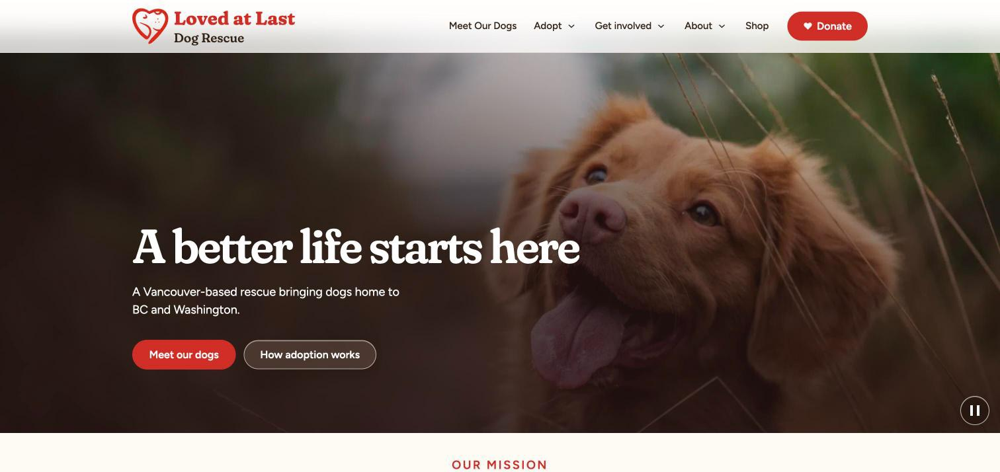<br><sub><b>Home.</b> Hero with pause control, rescue logo and donate button.</sub></td>
    <td width="50%">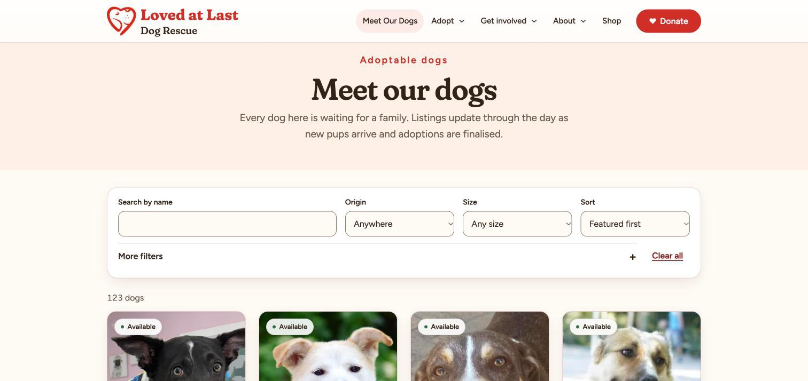<br><sub><b>Listing.</b> Every dog here comes straight from Petstablished, refreshed through the day.</sub></td>
  </tr>
  <tr>
    <td width="50%">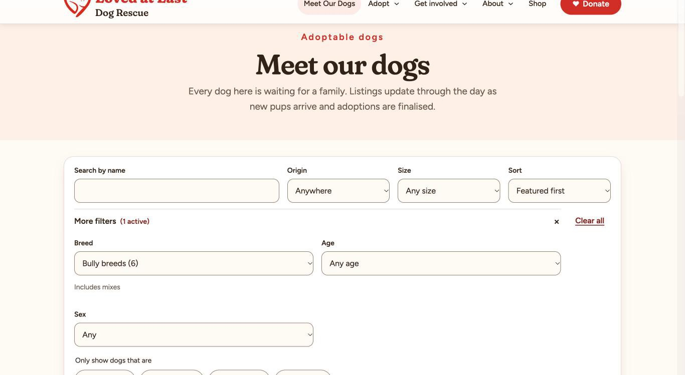<br><sub><b>Filters.</b> Breed families with counts, plus good with kids, dogs and cats from the shelter's own yes/no fields.</sub></td>
    <td width="50%">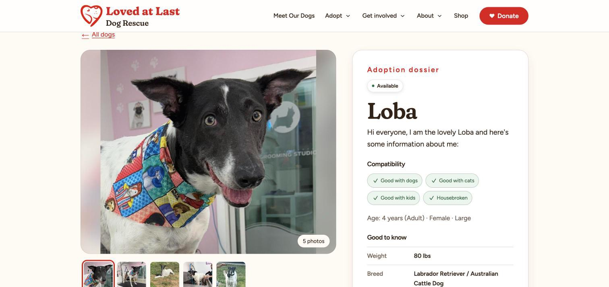<br><sub><b>Profile.</b> Photo gallery, compatibility, key facts and apply buttons.</sub></td>
  </tr>
  <tr>
    <td width="50%">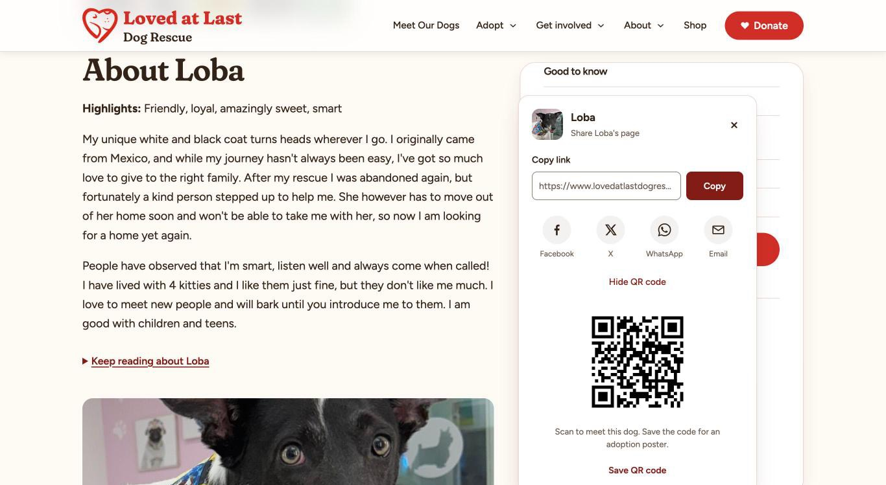<br><sub><b>Share.</b> Copy link, social links and a QR code made on the site, for adoption posters.</sub></td>
    <td width="50%">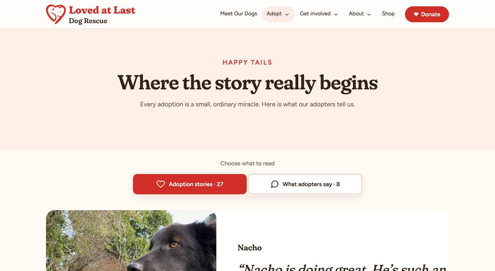<br><sub><b>Stories.</b> Adoption stories and adopter quotes in one place.</sub></td>
  </tr>
  <tr>
    <td width="50%">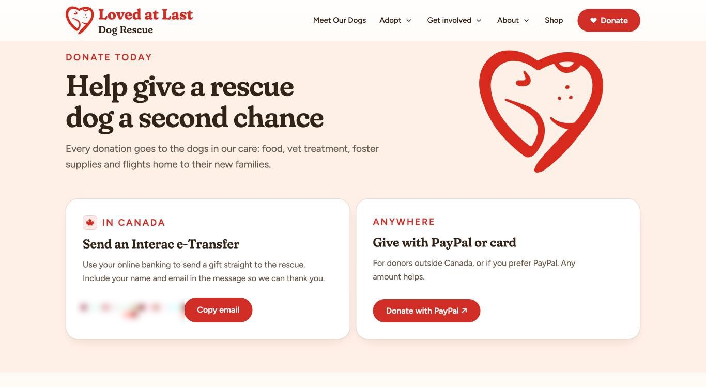<br><sub><b>Donate.</b> e-Transfer with a copy button, and PayPal for donors outside Canada.</sub></td>
    <td width="50%"></td>
  </tr>
</table>

## For developers

```sh
bin/test.sh          # PHP and JavaScript tests, no WordPress install needed
bin/scan-secrets.sh  # checks for keys, personal details and copied text before a push (optional private rules: copy .scan-secrets.local.example to .scan-secrets.local)
bin/build-zips.sh    # builds homeward-rescue.zip and homeward.zip into dist/
```

Requires PHP 8.1+ and Node for the tests.

```text
plugin/homeward-rescue/   the plugin: sync, blocks, stories, contact form, wizard
theme/homeward/           the companion block theme and bundled fonts
demo-content/             practice content and generated illustrations
docs/                     page guide and screenshots
bin/                      test, secret scan, zip build and image scripts
tests/                    PHP and JavaScript tests, fixtures
```

## Licence

GPL-2.0-or-later. See [LICENSE](LICENSE). The bundled fonts use the SIL Open Font License; see `theme/homeward/assets/fonts/`. The demo illustrations are CC0.
